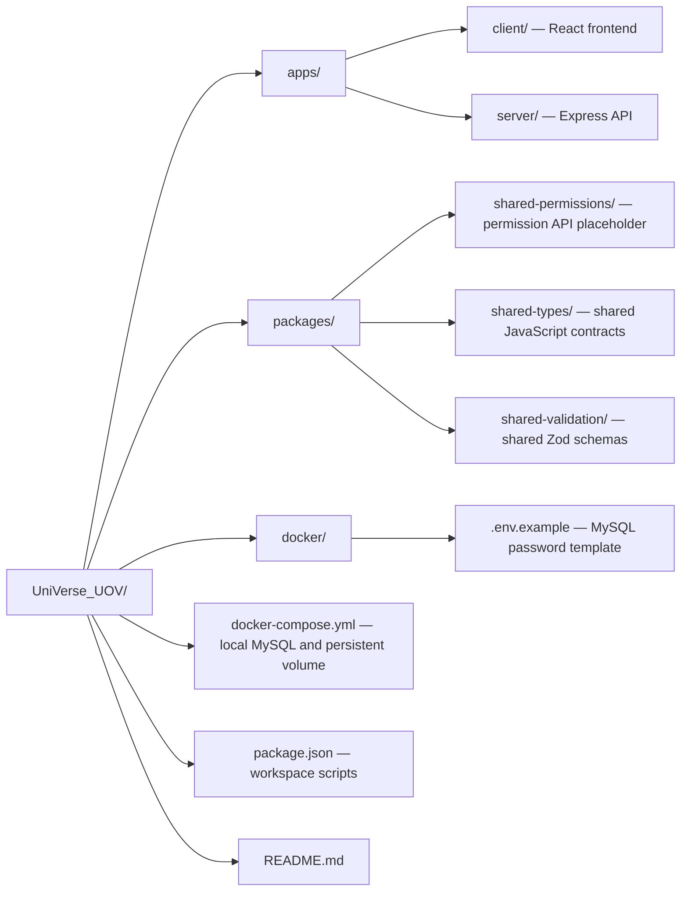
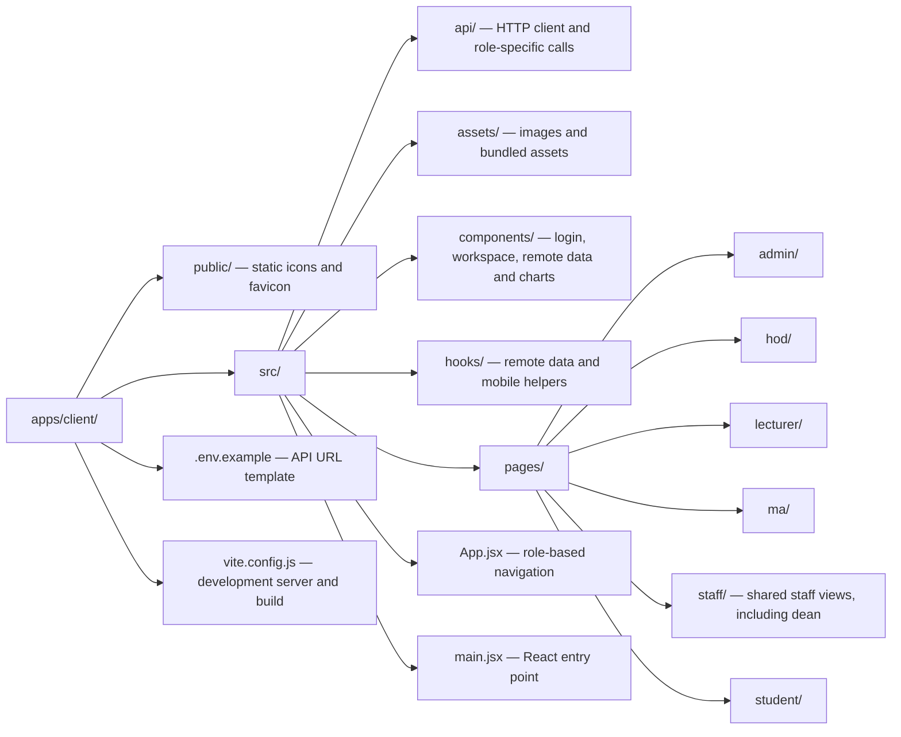
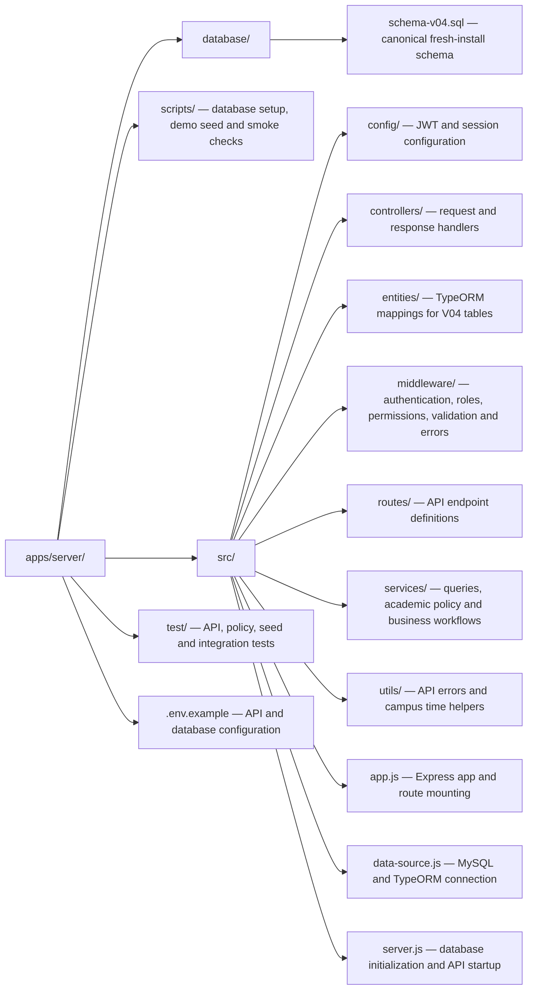

# UniVerse UOV

**Team members:** Follow [Local development](#local-development) and [Demo data](#demo-data) to start the Docker database, load sample data, and sign in.

Lecturer pages show assigned offerings, students, assessments, results, timetables, sessions and attendance. Role dashboards include charts built with Chart.js.

Integrated student services for the University of Vavuniya. The integrated implementation follows the supplied V04 database: Management Assistants create accounts, enter grades and record verification statuses; lecturers, HODs and deans view authorised records.

The canonical database is [schema-v04.sql](apps/server/database/schema-v04.sql). Runtime code lives in `apps/` and `packages/`; `docs/` is ignored by Git and may contain local working material.

## Technology and roles

This is an npm workspaces monorepo using JavaScript ES modules. The client uses React 19, Vite 8 and Chart.js 4. The server uses Express 5, TypeORM, MySQL 8, Zod validation, bcrypt password hashing, JWT sessions and PDFKit result exports.

| Role | Client path | Main features |
| --- | --- | --- |
| Student | `/student` | Own dashboard, published results, ICA assessments and result-summary PDF |
| Management Assistant (MA) | `/ma` | Account management, academic setup, grade entry, result status updates and audit activity |
| Lecturer | `/lecturer` | Assigned teaching records, timetable, sessions, attendance and result history |
| Head of Department (HOD) | `/hod` | Department dashboard and result tracking |
| Dean | `/dean` | Assigned department dashboard and result tracking |
| Administrator | `/admin` | University summary, result tracking, MA staff and audit activity |

Account creation and grade/status changes belong to the MA workflow. Permission checks also use the database's `ROLE_DEFAULT_PERMISSIONS` and `USER_PERMISSIONS` tables. The `shared-permissions` package currently contains a placeholder; server enforcement lives in middleware and services.

## Folder structure

The diagrams show the tracked application structure. Generated dependencies, build output and local-only working files are omitted.

### Repository overview



### Client workspace



### Server workspace



## API endpoints

The default API base URL is `http://localhost:4000/api`. The health endpoint is `GET http://localhost:4000/health` and returns service status without querying the database.

Routes are mounted in [app.js](apps/server/src/app.js). Every endpoint below requires `Authorization: Bearer <token>` except login. Send JSON request bodies with `Content-Type: application/json`. IDs are positive integers.

### Users and authentication

Source: [user.routes.js](apps/server/src/routes/user.routes.js).

| Method | Endpoint | Access / purpose |
| --- | --- | --- |
| POST | `/api/users/login` | Public; sign in with `{ email, password }`, returns `{ token, user }` |
| GET | `/api/users/me` | Any signed-in role; current session user |
| POST | `/api/users/password` | Any signed-in role; `{ currentPassword, password }`, returns `{ data: { token, user } }` |
| GET | `/api/users` | MA; paginated users, optional `q`, `role`, `status` filters |
| GET | `/api/users/summary` | MA; account totals by role |
| POST | `/api/users` or `/api/users/register` | MA + `users.create`; create a role-specific account |
| PATCH | `/api/users/:userId/status` | MA + `users.create`; activate/deactivate with `{ isActive }` |

New accounts may require a password change. Until it is completed, only `/api/users/me` and `/api/users/password` are available to that session. A password change invalidates previous tokens; use the replacement token returned by the password endpoint. Account payloads are defined in [shared-validation](packages/shared-validation/index.js).

### Student

Source: [student.routes.js](apps/server/src/routes/student.routes.js). All routes require `STUDENT` and return only the signed-in student's records. List/dashboard/download routes accept optional `semesterId`.

| Method | Endpoint | Purpose |
| --- | --- | --- |
| GET | `/api/student/dashboard` | Academic overview, subjects and dashboard metrics |
| GET | `/api/student/results` | Published final results |
| GET | `/api/student/results/:resultId` | Own published result details |
| GET | `/api/student/assessments` | ICA grades associated with published results |
| GET | `/api/student/downloads/result-summary` | Download `result-summary.pdf` (`application/pdf`) |

### Lecturer

Source: [lecturer.routes.js](apps/server/src/routes/lecturer.routes.js). All routes require `LECTURER` and a lecturer profile; records are scoped to assigned teaching work.

| Method | Endpoint | Purpose |
| --- | --- | --- |
| GET | `/api/lecturer/me` | Lecturer profile and capabilities |
| GET | `/api/lecturer/semesters` | Available teaching semesters |
| GET | `/api/lecturer/dashboard` | Teaching overview |
| GET | `/api/lecturer/offerings` | Assigned module offerings |
| GET | `/api/lecturer/offerings/:offeringId` | Offering details |
| GET | `/api/lecturer/offerings/:offeringId/students` | Enrolled students |
| GET | `/api/lecturer/assessments` | Assessments; requires `results.status.view` |
| GET | `/api/lecturer/results` | Results; requires `results.status.view` |
| GET | `/api/lecturer/offerings/:offeringId/assessments` | Offering assessments; requires `results.status.view` |
| GET | `/api/lecturer/offerings/:offeringId/results` | Offering results; requires `results.status.view` |
| GET | `/api/lecturer/timetable` | Teaching timetable |
| GET | `/api/lecturer/sessions` | Lecture sessions |
| GET | `/api/lecturer/sessions/:sessionId` | Session details |
| GET | `/api/lecturer/sessions/:sessionId/attendance` | Session attendance |
| GET | `/api/lecturer/results/:resultId` | Result details; requires `results.status.view` |
| GET | `/api/lecturer/results/:resultId/history` | Result status history; requires `results.status.view` |
| POST | `/api/lecturer/sessions` or `/api/lecturer/sessions/:sessionId/close` | Disabled; returns `403 SESSION_CONTROL_DISABLED` |

Lecturer query-enabled routes accept `page`, `pageSize`, `semesterId`, `offeringId`, `search`, `status`, `from` and `to` as applicable to the operation. Dates use `YYYY-MM-DD`; a supplied `from`/`to` range must be ordered and at most 93 days. Hall-terminal session control is not integrated.

### Staff

Source: [staff.routes.js](apps/server/src/routes/staff.routes.js). These routes admit `ADMIN`, `HOD`, `DEAN` and `MA`, with the additional restrictions below. HOD and dean results are scoped to their assigned department.

| Method | Endpoint | Access / purpose |
| --- | --- | --- |
| GET | `/api/staff/dashboard` | Staff dashboard |
| GET | `/api/staff/results` | `results.status.view`; paginated results, optional `search` and `status` |
| GET | `/api/staff/results/:resultId/history` | `results.status.view`; result status history |
| GET | `/api/staff/audit` | ADMIN or MA; paginated audit activity |
| GET | `/api/staff/ma-staff` | ADMIN; paginated MA staff records |

### MA dashboard, academic setup and lookups

All routes in this group require `MA`.

| Route file | Method | Endpoint | Purpose |
| --- | --- | --- | --- |
| [dashboard.routes.js](apps/server/src/routes/dashboard.routes.js) | GET | `/api/ma/dashboard` | MA dashboard totals |
| [academic.routes.js](apps/server/src/routes/academic.routes.js) | GET | `/api/ma/academic/resources` | Resource catalog, fields and availability |
| academic.routes.js | GET | `/api/ma/academic/:resource` | Paginated resource records |
| academic.routes.js | POST | `/api/ma/academic/:resource` | Create; requires `timetable.write` |
| academic.routes.js | PATCH | `/api/ma/academic/:resource/:id` | Update; requires `timetable.write` |
| [lookup.routes.js](apps/server/src/routes/lookup.routes.js) | GET | `/api/ma/lookups/roles` | Roles |
| lookup.routes.js | GET | `/api/ma/lookups/departments` | Departments |
| lookup.routes.js | GET | `/api/ma/lookups/programmes` | Programmes |
| lookup.routes.js | GET | `/api/ma/lookups/batches` | Batches |
| lookup.routes.js | GET | `/api/ma/lookups/grade-scale` | Grade scale |
| lookup.routes.js | GET | `/api/ma/lookups/programme-semesters` | Curriculum semesters |

Supported academic resource keys are `departments`, `programmes`, `batches`, `calendar-semesters`, `modules`, `programme-semesters` and `halls`. Consult the resource catalog for fields before sending create/update payloads.

### MA grade entry and result workflow

Source: [result.routes.js](apps/server/src/routes/result.routes.js). All routes require `MA` and an MA staff profile.

| Method | Endpoint | Permission / purpose |
| --- | --- | --- |
| GET | `/api/ma/results/transitions` | `results.status.update`; allowed status transitions |
| GET | `/api/ma/results/offerings` | `grades.write`; grade-entry offering choices |
| GET | `/api/ma/results/entry-context/:offeringId` | `grades.write`; enrollments, exams, ICAs and grades |
| POST | `/api/ma/results/final-grades` | `grades.write`; `{ enrollmentId, examId, examGrade, finalGrade }` |
| POST | `/api/ma/results/ica-grades` | `grades.write`; `{ enrollmentId, icaId, grade }` |
| POST | `/api/ma/results/:resultId/status` | `results.status.update`; `{ fromStatus, toStatus, note? }` |

The workflow is `ENTERED → VALIDATED → WITH_DEAN_OFFICE → PUBLISHED`. The first three states can move to `RETURNED`, which can move back to `ENTERED`. Published results have no outgoing transition. Final grades can be edited only in `ENTERED` or `RETURNED`; grade values must exist in the configured grade scale.

### API conventions

Paginated routes use `page` (default `1`) and `pageSize` (default `25`, maximum `100`) and generally return `{ data, meta }`. Other JSON data endpoints generally return `{ data }`; login returns `{ token, user }`. Health and PDF downloads use their own formats. Errors use `{ error: { code, message } }` with an appropriate HTTP status, including `400` for validation, `401` for invalid sessions, `403` for denied access, `404` for missing records, `409` for conflicts and `503` for unavailable schema.

## Local development

Use Node 22.12 or newer and MySQL 8. Run the commands below from the repository root. Copy `apps/server/.env.example` to `apps/server/.env` and set the database credentials and a strong `JWT_SECRET`. Optionally copy `apps/client/.env.example` to `apps/client/.env` to override the API URL.

| File | Variables | Configuration |
| --- | --- | --- |
| `apps/server/.env` | `PORT` | API port; default `4000` |
| `apps/server/.env` | `DB_HOST`, `DB_PORT`, `DB_USER`, `DB_PASSWORD`, `DB_NAME` | Example targets `localhost:3307`, user `root`, database `universe_uov_v04`; match your MySQL installation |
| `apps/server/.env` | `JWT_SECRET`, `JWT_EXPIRES_IN` | Required signing secret and token lifetime (default `8h`) |
| `apps/server/.env` | `FRONTEND_URL` | Comma-separated allowed client origins; example includes localhost and 127.0.0.1 on port 5173 |
| `apps/server/.env` | `GPA_REPEAT_POLICY`, `PASSING_GRADES` | Optional approved academic calculation rules |
| `apps/client/.env` | `VITE_API_BASE_URL` | Defaults to `http://localhost:4000/api` |
| `docker/.env` | `MYSQL_ROOT_PASSWORD` | Required by Docker Compose; match the server's `DB_PASSWORD` when using root |

For a new Docker installation, copy `docker/.env.example` to `docker/.env`, set its password to match the server configuration, then run:

```powershell
docker compose --env-file docker/.env up -d
npm install
npm run db:check-v04 -w apps/server
npm run dev
```

Docker installs V04 only when its MySQL data volume is empty. Existing databases require a separate migration or a new database; the V04 SQL contains destructive fresh-install statements. `npm run db:setup-v04 -w apps/server` creates a separate `universe_uov_v04` database, adds the bootstrap MA and updates this checkout's database name. It refuses to overwrite an existing database.

For a fresh Docker volume that already created V04, use `npm run create:ma -w apps/server` with `MA_EMAIL`, `MA_NAME` and `MA_PASSWORD` set to create its first MA. Use a temporary password of 12–72 characters and at most 72 UTF-8 bytes; first sign-in requires a password change. The command refuses to create another bootstrap MA when an MA profile already exists. Alternatively, use the demo seed below for local demonstration accounts. If you used `db:setup-v04`, its generated bootstrap sign-in details are stored in the ignored `.local/v04-access.json`.

The client runs at `http://127.0.0.1:5173`. The API runs at `http://localhost:4000`.

Use `npm run dev:client` or `npm run dev:server` to run either workspace independently. `npm run build` creates the client production bundle in `apps/client/dist`; `npm run preview -w apps/client` previews it locally. `npm start -w apps/server` starts the API without watch mode. MySQL dates and times use the campus offset `+05:30`. TypeORM schema synchronization and automatic migration execution are disabled; use the documented schema/setup commands.

## Demo data

With the MySQL container running and dependencies installed, run from the repository root:

```powershell
npm run seed:demo
```

The command uses `apps/server/.env` to connect to your container's database
(`localhost:3307`, `universe_uov_v04` by default). It also works from the server
workspace with `npm run seed:demo -w apps/server`. The V04 schema must already
be installed; this command does not recreate the database.

It adds 28 fictional students, accounts for all five staff roles, a demo ICT
programme, three modules across three terms, four offerings, timetable slots,
attendance, ICA grades, 86 final results with status histories, and two resit
attempts. Dates are based on the current campus teaching half-year when first
seeded. Existing records and grade scales are preserved; an empty grade scale
gets a fictional A/B/C/F scale for the demo.

| Role     | Email                                                    |
| -------- | -------------------------------------------------------- |
| MA       | `demo.seed.ma@example.test`                              |
| Lecturer | `demo.seed.lecturer@example.test`                        |
| HOD      | `demo.seed.hod@example.test`                             |
| Dean     | `demo.seed.dean@example.test`                            |
| Admin    | `demo.seed.admin@example.test`                           |
| Student  | `demo.seed.student01@example.test` (through `student28`) |

All new demo accounts use **`UniVerseDemo@2026!`**, with no first-login password
change. To use another password, set `DEMO_PASSWORD` before the first run:

```powershell
$env:DEMO_PASSWORD = "YourOwnDemoPassword@2026!"
npm run seed:demo
Remove-Item Env:DEMO_PASSWORD
```

The seed commits in one transaction and records completion in `AUDIT_LOG`.
Running it again leaves the demo records and any subsequent edits unchanged,
including passwords. Conflicting demo emails or codes cause the transaction
to roll back. The command refuses to run with `NODE_ENV=production`.
Academic calculation settings remain controlled by your existing configuration.

## Checks

```powershell
npm test
npm run lint
npm run build
npm run format:check
npm run test:docker -w apps/server
npm run test:seed:demo -w apps/server
npm audit
```

Docker checks create and remove a uniquely named test database on the configured MySQL server. They leave application data intact and include headless Edge checks for all six roles. Set `EDGE_PATH` when Edge is installed elsewhere. `npm run test:v04 -w apps/server` alternatively launches a temporary MySQL instance; set `MYSQLD_PATH` for a different installation.

The demo seed check uses a disposable database to verify rollback, preservation
of existing data, repeated runs, resit relationships, and sign-in for all six roles.

Academic calculation settings remain optional until university policy is approved. Unconfigured repeat/pass rules, ambiguous programme GPA and unsupported requirement totals are shown as unavailable.
